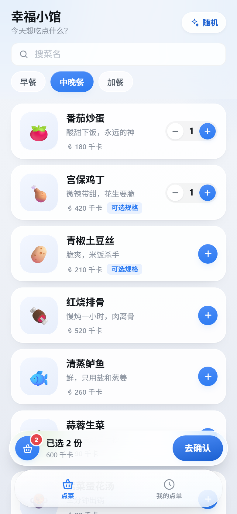
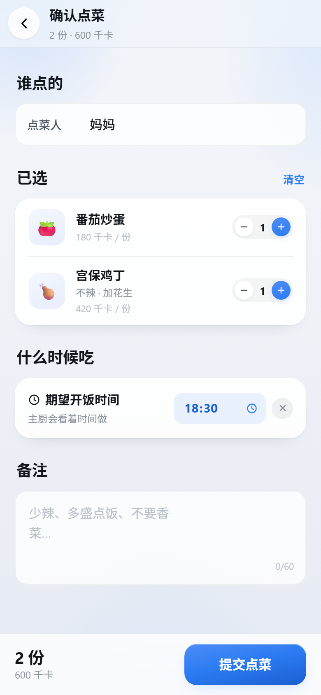
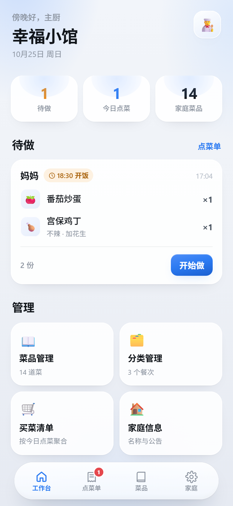
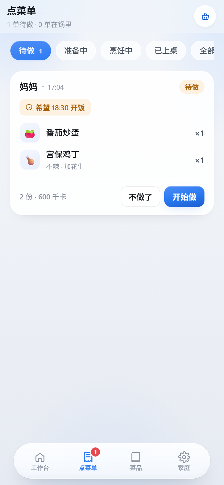
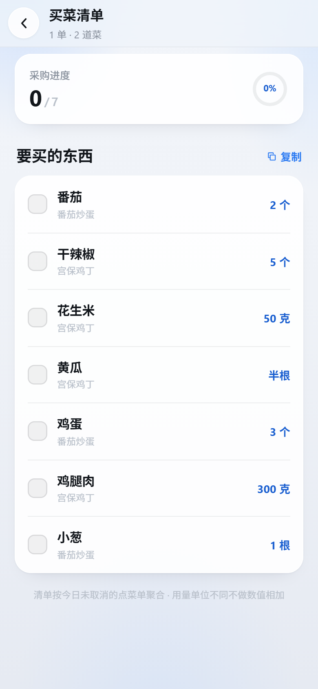
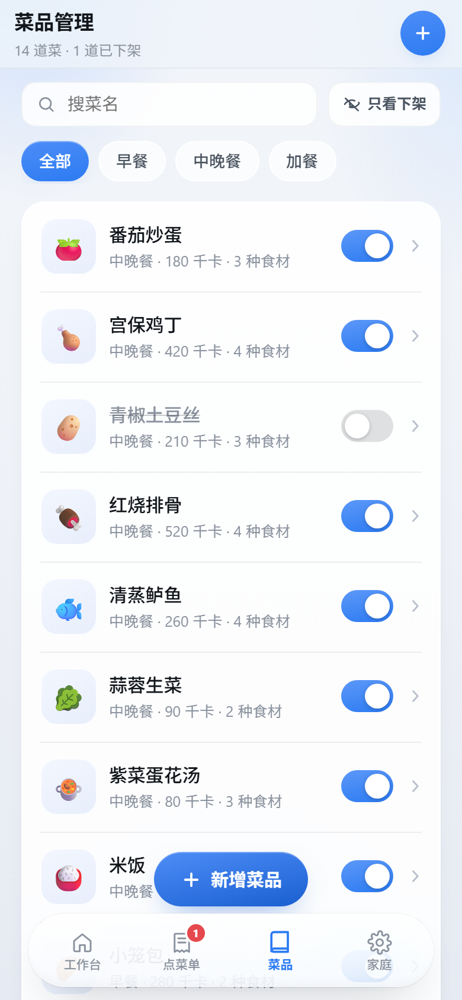
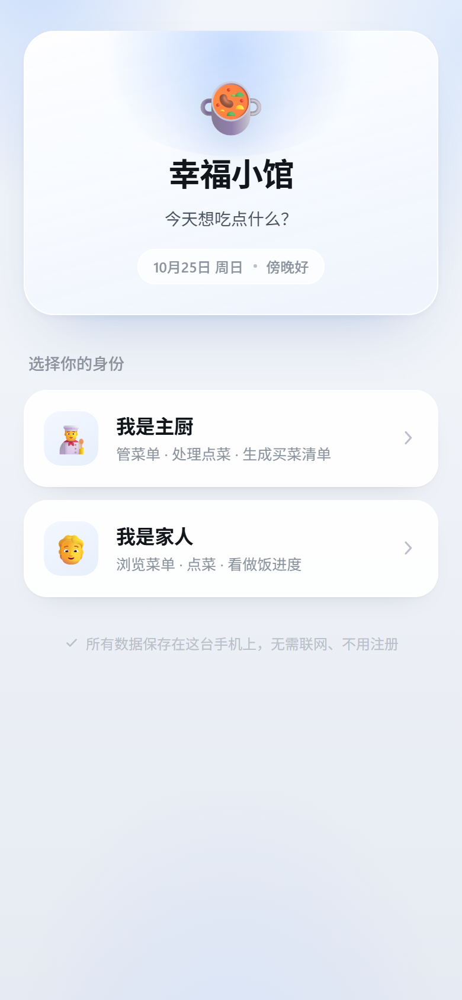

<p align="center">
  
</p>

<h1 align="center">幸福小馆</h1>

<p align="center"><b>给一家人用的点菜 App —— 手机上选好菜，厨房里直接接单。</b></p>

<p align="center">
  
  
  
  
  
  
</p>

---

## 这是什么

家里做饭最烦的不是做菜，是**对齐**：谁想吃啥、几点吃、要买什么料，全靠微信群里喊。喊完还得有人记、有人买。

这个 App 把这件事收进一个手机屏幕里：

- **家人**打开就能点菜，选规格、填份数、备注「少辣」「多盛点饭」，指定几点开饭
- **主厨**打开就看到待做清单，一单一单「开始做 → 已上桌」
- 点完自动汇总成**买菜清单**，按食材聚合用量（番茄 2 个、鸡腿肉 300 克），买一样勾一样

没有账号、没有服务器、不联网，装上就能用。做饭的人不用再当记工。

## 界面

| 点菜 | 确认下单 | 主厨工作台 |
|:---:|:---:|:---:|
|  |  |  |
| 按餐次分类，底部实时显示已选与热量 | 点菜人必填，可选开饭时间与备注 | 待做、今日点单、菜品数一屏看全 |

| 点菜单 | 买菜清单 | 菜品管理 |
|:---:|:---:|:---:|
|  |  |  |
| 五状态逐单流转，从待做到已上桌 | 按食材聚合，不同单位不相加 | 开关即上下架，下架后家人看不到 |

## 功能

首次打开选身份，之后随时可切换。数据全在**同一台设备**上，主厨和家人在同一部手机/平板上传着用。

| 能力 | 家人 | 主厨 |
|---|:---:|:---:|
| 浏览菜单、按餐次筛选、搜菜名 | ✓ | ✓ |
| 选规格（辣度、加料，必选项未选不能加入） | ✓ | |
| 份数加减、备注、随机推荐、再来一份 | ✓ | |
| 查看自己的点单与做菜进度 | ✓ | |
| 工作台：待做 / 今日点单 / 菜品数 | | ✓ |
| 接单流转：开始做 → 已上桌 / 不做了 | | ✓ |
| 菜品增删改（图片、分类、热量、食材、规格组） | | ✓ |
| 菜品上下架（下架后家人菜单里消失） | | ✓ |
| 买菜清单按今日未取消订单聚合，一键复制 | | ✓ |
| 分类管理、店名与公告、数据备份 / 恢复 | | ✓ |

## 技术栈

| 层 | 选择 | 说明 |
|---|---|---|
| 框架 | Vue 3.5 `<script setup>` | 无状态库、无 UI 库、无路由库 |
| 构建 | Vite 6 | 前端产物约 205 KB（JS 156 KB + CSS 48 KB），gzip 后 ~60 KB |
| 壳 | Capacitor 7 | Web 跑在原生 WebView 里，含 Haptics / StatusBar 插件 |
| 路由 | 自写 hash 路由（`src/store/router.js`） | 11 个页面，不需要 vue-router |
| 存储 | localStorage + IndexedDB | 业务数据与图片分开存，见下 |

## 快速开始

只需要 Node（开发过的是 22，18+ 均可）：

```bash
git clone git@github.com:betterccyan/app-android.git
cd app-android
npm install
npm run dev          # http://127.0.0.1:5180
```

浏览器里按 F12 → 切换设备工具条，用手机尺寸看效果。这是纯前端项目，改完即时热更新。

首次打开会让你选身份：



## 构建 APK

需要 **JDK 21** 和 **Android SDK 35**。Capacitor 7 的安卓依赖用 Java 21 编译，JDK 17 会报 `无效的源发行版：21`。

```bash
export JAVA_HOME=/path/to/jdk-21
export ANDROID_HOME=/path/to/android-sdk     # 含 platforms;android-35、build-tools;35.0.0

npm run apk
# 产物：android/app/build/outputs/apk/debug/app-debug.apk
```

`npm run apk` = 构建前端 → 同步进安卓工程 → Gradle 打包。Android Studio 不是必需的；要用就用「Open an Existing Project」打开 `android/` 目录。

<details>
<summary>Windows 上的两个已知问题</summary>

1. **中文路径**：Gradle 默认拒绝非 ASCII 项目路径。`android/gradle.properties` 里已加 `android.overridePathCheck=true`。
2. **环境变量**：`.vscode/settings.json` 已把 `JAVA_HOME` / `ANDROID_HOME` 注入集成终端，用 VS Code 打开本项目时不用手动 export。

</details>

## 常用脚本

| 命令 | 作用 |
|---|---|
| `npm run dev` | 开发预览（5180） |
| `npm run build` | 只构建前端产物 |
| `npm run sync` | 构建 + 同步进安卓工程 |
| `npm run apk` | 全流程打包 debug APK |
| `node tools/diag-scroll.mjs` | **全页面滚动体检**，11 个页面逐个量 `scrollHeight` |
| `node tools/shots.mjs` | 跑完整点菜流程并截图到 `shots/` |
| `node tools/doc-shots.mjs` | 生成 README 用的截图到 `docs/screenshots/` |
| `node tools/verify-shelf.mjs` | 校验上下架开关、提示语、计数三者一致 |
| `node tools/verify-hidden.mjs` | 校验下架的菜在家人端确实消失 |
| `node tools/gen-icons.mjs` | 从 `tools/icon-src.mjs` 的 SVG 母版重生成全部图标与启动图 |

## 目录结构

```
app-android/
├── src/
│   ├── views/            11 个页面（RoleSelect / OwnerHome / MenuPage / Checkout …）
│   ├── components/       TabBar、PageHeader、Stepper、OptionSheet、DishAvatar …
│   ├── data/             db.js（唯一数据出口）+ seed.js（14 道初始菜品）
│   ├── store/            router.js（hash 路由）、app.js（toast / haptic）
│   ├── lib/              options.js、ingredients.js、image-store.js、util.js
│   └── styles/           tokens.css（设计变量）、base.css（通用组件样式）
├── android/              Capacitor 生成的原生工程（图标、启动图、Manifest）
├── tools/                截图、滚动体检、图标生成等脚本
├── docs/                 README 用图
└── capacitor.config.json
```

## 数据存在哪

| 数据 | 位置 | 键名 |
|---|---|---|
| 菜品、分类、订单、设置、当前身份 | localStorage | `xfk_db_v1` |
| 菜品图片（压缩后的 blob） | IndexedDB | `xfk_images` / `blobs` |

业务数据走 `src/data/db.js` 这一个出口，用 Vue `reactive` 保证响应式，改动自动落盘。**要接云端同步，只改这一个文件**。

localStorage 只有 5MB 配额，所以图片单独放 IndexedDB —— 这是两套存储分开的原因。

## 设计规范

视觉参考**小米澎湃OS 4「柔光玻璃」**，落成一套 token（`src/styles/tokens.css`）：

| 项 | 值 |
|---|---|
| 强调色 | `#2C7BF2` 澎湃蓝，全局唯一彩色（语义色除外） |
| 背景 | `#EFF2F7` 冷灰蓝 + 三处 radial 柔光斑 |
| 卡片 | `rgba(255,255,255,.88)` + 1px 内高光描边分层，不用重投影 |
| 圆角 | 15 / 20 / 26 px 三档，胶囊按钮 999px |
| 玻璃 | `backdrop-filter` 只用在底部导航、顶栏、购物车栏、固定底栏这几处固定浮层，列表卡一律半透明白 |

App 图标是**白瓷碗 + 暖橙汤面 + 一双斜搭在碗沿的筷子**。筷子画在碗之后、末端藏进碗身，既不会出现悬空钝头，也避开了「筷子直插碗中」的忌讳。母版是 SVG（`tools/icon-src.mjs`），按目标像素直接渲染，不做缩放插值，48px 下边缘依然干净。

## 已知限制

- **单机数据**：两台手机之间不互通。换手机要用「家庭信息 → 复制备份」导出文本再恢复。
- **无推送**：家人下单后，主厨要打开 App 才看得到（有未读角标，但没有通知栏提醒）。
- **debug 签名**：不是上架包，国产 ROM 安装时提示「未经安全检测」属正常，选继续安装即可。
- **清数据即丢**：卸载 App 或在系统里「清除数据」，本地记录会一起没，重要数据请先备份。

## 开发约定

几条踩过的坑，改代码前值得知道：

1. **页面能不能滚，靠高度链**。`#app` → `.safe-top` → `.page-root` → `.scroll` 每一层都要 `min-height: 0`，断一层就变成「只能看不能滑」，而截图完全看不出来。改布局后跑 `node tools/diag-scroll.mjs`。
2. **先改状态再读状态，提示语会反**。`toggleDishAvailable()` 是就地取反，`toast()` 要按切换**后**的值措辞。
3. **弹窗要 Teleport**。`.page-root` 上带 `animation` 会创建 stacking context，把 `z-index: 101` 的弹窗压到 `z-index: 60` 的底部导航下面，按钮点不到。`OptionSheet` 用 `<Teleport to="body">` 解决。
4. **`backdrop-filter` 是性能红线**。只在固定浮层用，别往列表项上加。

## 协议

[MIT](LICENSE) © 2026 chaochao_yan

随便用、随便改、随便拿去改成你家的菜单，商用也行，保留版权声明即可。项目按「现状」提供，不附带任何担保。

> 本项目是给自家厨房写的，代码结构和命名都围绕「一家人的餐桌」展开。没有多租户、没有权限体系、没有并发处理——如果你要拿去做门店点单，数据库那层得重写（入口在 `src/data/db.js`）。
